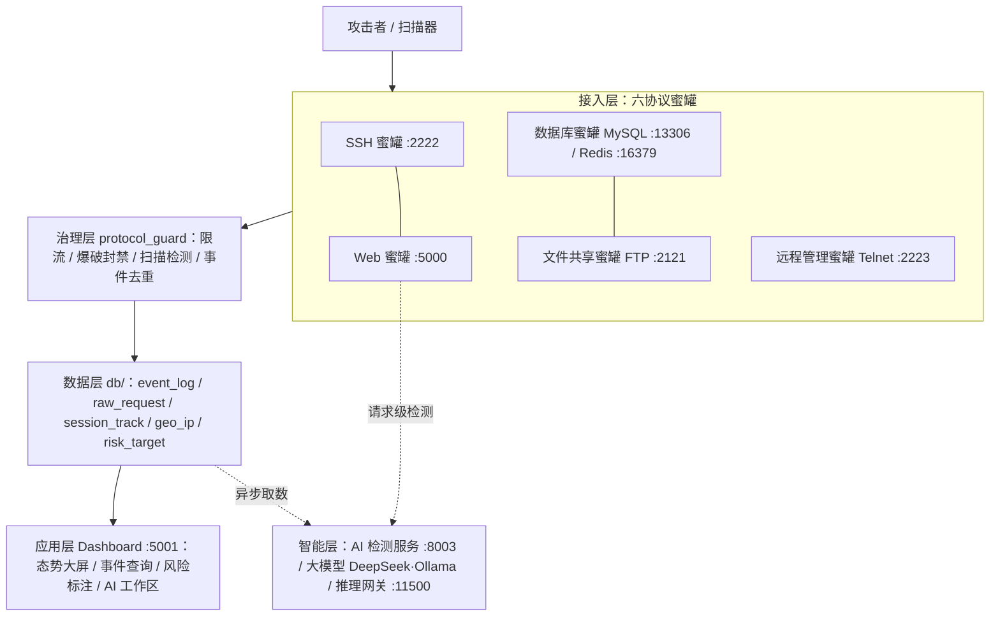

# 网络威胁态势感知与蜜罐诱捕系统

本项目是一个面向教学演示、竞赛评审与受控安全研究的多协议蜜罐系统：对外提供 **SSH / Web / MySQL / Redis / FTP / Telnet 六类诱捕服务**，由 **主控进程 + 态势大屏 + AI 检测与研判工作区**统一编排，用于采集攻击载荷、判定其内容风险并形成可追溯的证据链。

项目目标是把 SSH 登录、Web 探测、后台撞库、SQL 注入、XSS、敏感文件探测等行为引导到可控环境中，并通过统一事件模型记录、聚合和展示攻击轨迹。本项目仅用于合法授权的教学、演示和防御研究，不用于承载真实生产业务。

## 团队信息

| 姓名 | 角色 | 主要负责模块 |
| --- | --- | --- | --- |
|唐春霞| 队长-AI 与检测 测试与文档 | `utils/ai_*.py`、请求级检测服务（`xss_detector`）、 `scripts/`、`docs/`  |
|陈梓铭| 架构与后端 | `main.py`、`app_config.py`、`db/` |
|郑旭翔| 前端与可视化 | `dashboard/templates`、`dashboard/static` |


## 文档导航

- [API 文档](API.md)：Dashboard API、Web 蜜罐接口、诱饵后台接口说明
- [配置模板](honeypot.ini.example)：根目录统一配置文件模板
- [脚本说明](scripts/README.md)：启动、部署与演示脚本说明
- [仓库提交说明](docs/06-仓库提交说明.md)：上传清单、密钥排除与 Git 流程

## 系统入口

| 入口 | 作用 | 默认本地地址 | 账号口径 |
| --- | --- | --- | --- |
| SSH 蜜罐 | 诱捕 SSH 登录、命令执行、SCP 上传等行为 | `ssh root@127.0.0.1 -p 2222` | 诱饵凭证，启动时动态生成 |
| Web 蜜罐 | 模拟企业网站、诱饵后台、敏感路径与攻击入口 | `http://127.0.0.1:5000/` | 公共页面无需登录；`/admin` 为诱饵后台 |
| Dashboard 管理端 | 查看真实事件、统计图表、会话分析和态势展示 | `http://127.0.0.1:5001/super/login` | 使用 `[admin] user/password` |

注意：

- Web 的 `/admin` 是**诱饵后台**，不是 Dashboard。
- Dashboard 的真实登录入口是 `/super/login`，登录后主页面是 `/dashboard`。
- Web/SSH 的诱饵凭证与 Dashboard 管理员密码相互独立。

## 项目结构

```text
honeypot-system/
├─ main.py                   # 统一启动入口：端口预检 / 日志流式汇聚 / 崩溃自动重启
├─ app_config.py             # 统一配置读取：环境变量 > honeypot.ini > 代码默认值
├─ env_utils.py              # 配置读取工具函数
├─ honeypot.ini.example      # 主配置模板（复制为 honeypot.ini）
├─ ai.local.ini.example      # AI 配置模板（复制为 ai.local.ini）
├─ .env.example              # 环境变量模板（systemd / 容器场景）
├─ requirements.txt          # 依赖清单（不使用 uv 时使用）
├─ pyproject.toml / uv.lock  # 依赖声明与版本锁定
├─ ssh_honeypot/             # SSH 蜜罐：终端仿真、虚拟文件系统、命令审计
├─ web_honeypot/             # Web 蜜罐：企业站、诱饵后台、陷阱路由、伪 API
├─ db_honeypot/              # MySQL / Redis 协议仿真
├─ file_honeypot/            # FTP 协议仿真
├─ remote_honeypot/          # Telnet（IoT）协议仿真
├─ dashboard/                # 管理端大屏：统计、地图、攻击链、AI 工作区
├─ team_center/              # 可选：团队数据中心
├─ ai_gateway/               # 可选：AI 推理网关（持久化队列）
├─ db/                       # 数据层：事件、原始请求、会话、地理、风险标注、归档
├─ utils/                    # 治理层与工具：限流封禁、日志、告警、地理、AI 封装
├─ evaluation/               # 评测样本集与评测脚本
├─ scripts/                  # 启动、部署、演示、验收脚本
├─ docs/                     # 设计文档、测试报告、运行截图
└─ database/                 # 建表 SQL（运行库 *.db 不入库）
```

仓库约定：**只提交代码、模板与文档**；`honeypot.ini`、`ai.local.ini`、`.env`、`*.db`、`logs/` 等已在
`.gitignore` 中排除，上传清单与自检命令见 [docs/06-仓库提交说明.md](docs/06-仓库提交说明.md)。

## 技术架构

系统采用「主控进程 + 多子服务进程」结构，自上而下分为五层，由 `main.py` 统一编排、统一回收日志：



| 层次 | 职责 | 主要模块 |
| --- | --- | --- |
| 接入层（蜜罐仿真） | 协议仿真、诱饵交互、攻击行为捕获与特征采样 | `ssh_honeypot/`、`web_honeypot/`、`db_honeypot/`、`file_honeypot/`、`remote_honeypot/` |
| 治理层（公共防护） | 并发限制、爆破封禁、扫描检测、事件去重与评分上报 | `utils/protocol_guard.py`（`ConnectionGuard` / `ProtocolReporter`） |
| 数据层 | 统一事件、原始请求、会话追踪、地理缓存、风险目标标注、冷归档 | `db/` |
| 应用层（管理端） | 态势可视化、事件查询、风险标注、AI 分析工作区 | `dashboard/` |
| 智能层（可选，默认关闭） | 请求级攻击检测、大模型研判、推理网关、团队协作 | `utils/ai_*.py`、`utils/local_ai.py`、`ai_gateway/`、`team_center/` |

**两条 AI 链路**（互不阻塞，失败自动降级）：

1. **请求级检测（在线）**：Web 请求落 `raw_request` → 规则特征评分（0～100）→ 异步调用 `/api/v1/detect`
   取得 `ai_points`（0～25）→ `final = min(100, 规则 + ai)` → ≥20 记可疑、≥40 记高危 → 大屏实时标签；
2. **大模型研判（异步）**：游标批量取事件 → 证据选择 → JSON Schema 约束的结构化报告 → 人工复核；
   模型只能从封闭策略集里选择，不生成可执行内容、不访问提交的地址。

设计原则：**接入与治理分离、统一事件口径、规则优先 AI 增量、默认关闭显式启用、失败可降级**。
详细设计见 [docs/01-概要设计说明书.md](docs/01-概要设计说明书.md) 与 [docs/02-详细设计说明书.md](docs/02-详细设计说明书.md)。

## 技术栈

| 领域 | 选型 | 说明 |
| --- | --- | --- |
| 语言 / 运行时 | Python 3.11+（环境 3.12） | 全系统统一，依赖由 uv 管理 |
| Web 框架 | Flask + Werkzeug | Dashboard、Web 蜜罐、team_center、ai_gateway |
| SSH 协议 | Paramiko | SSH 蜜罐服务端仿真 |
| 存储 | SQLite（默认）/ MySQL（可选） | 统一 `db/connection.py` 双后端 |
| 前端 | 原生 HTML/CSS/JS + ECharts | 无构建链，CSP 严格同源 |
| 请求级 AI 检测 | FastAPI + uvicorn；字符级 TF-IDF + 逻辑回归 | 独立服务（默认 `127.0.0.1:8003`），CPU 推理 |
| 大模型研判 | DeepSeek / 本地 Ollama / 自建推理网关 | 统一 `utils/local_ai.py` 封装，可切换 |
| 依赖与部署 | uv（`pyproject.toml` + `uv.lock`）、systemd | Windows / Linux 均可 |

## 快速启动

### 1. 安装依赖

```bash
uv sync
```

如果没有安装 `uv`，请先参考官方文档安装：<https://github.com/astral-sh/uv>

### 2. 创建本地配置

Windows：

```powershell
copy honeypot.ini.example honeypot.ini
```

Linux/macOS：

```bash
cp honeypot.ini.example honeypot.ini
```

然后编辑根目录 `honeypot.ini`。常用配置项：

```ini
[app]
production_mode = false
show_summary_creds = true

[admin]
user = admin
password =

[services.ssh]
port = 2222

[services.web]
port = 5000

[services.dashboard]
port = 5001

[database]
type = sqlite
path = ./database/event_logs.db
```

说明：

- `honeypot.ini` 是本机真实运行配置，可能包含密码、Webhook、密钥，不要公开。
- 读取优先级为：**环境变量 > honeypot.ini > 代码默认值**。

### 3. 启动项目

```bash
uv run python main.py
```

启动成功后会拉起：

- SSH 蜜罐
- Web 蜜罐
- Dashboard 管理端

默认本地访问：

```text
SSH:       127.0.0.1:2222
Web:       http://127.0.0.1:5000/
Dashboard: http://127.0.0.1:5001/super/login
```

## 环境配置

| 项 | 说明 |
| --- | --- |
| Python | 3.11+（开发与验收环境为 3.12） |
| 依赖清单 | `pyproject.toml`（声明）+ `uv.lock`（锁定）；不使用 uv 时用 `requirements.txt` |
| 配置模板 | `honeypot.ini.example`（主配置）、`ai.local.ini.example`（AI 配置） |
| 环境变量模板 | `.env.example`（systemd / 容器场景；环境变量优先级高于 ini） |
| 运行产物 | `logs/`、`database/*.db`（本地生成，不入库） |

```powershell
uv sync                                   # 或：pip install -r requirements.txt
copy honeypot.ini.example honeypot.ini     # 首次运行生成真实配置
copy ai.local.ini.example ai.local.ini     # 需要大模型能力时再填 Key
uv run python main.py
```

> 仓库中不包含任何真实配置与密钥。AI Key 建议用环境变量注入（`HONEYPOT_AI_API_KEY`），
> 避免写入文件；未配置时全部 AI 功能安全降级为纯规则，系统仍可完整运行。

## 启动脚本

### Windows

```powershell
scripts\run.bat
```

### Linux

```bash
bash scripts/run_prod.sh
```

脚本会检查根目录 `honeypot.ini`，不存在时从 `honeypot.ini.example` 生成。脚本不再重复维护端口、数据库、告警等默认值，统一由 `app_config.py` 读取根目录配置。

## systemd 部署

适用于云服务器常驻运行：

```bash
cd /your/project/path
uv sync
bash scripts/install_systemd.sh /your/project/path honeypot
```

安装后 systemd 会通过以下环境变量指定统一配置文件：

```text
HONEYPOT_CONFIG=/your/project/path/honeypot.ini
```

部署前请编辑根目录 `honeypot.ini`，尤其是：

- `[app] production_mode`
- `[admin] password`
- `[database]` 数据库配置
- `[alerting]` 告警配置

## 配置说明

配置集中在 [app_config.py](app_config.py) 中读取，模板见 [honeypot.ini.example](honeypot.ini.example)。

### 配置优先级

1. 环境变量
2. 根目录 `honeypot.ini`
3. 代码默认值

### 关键配置项

| 分组 | 配置 | 说明 |
| --- | --- | --- |
| `[app]` | `production_mode` | 是否生产模式；生产模式必须设置管理端密码 |
| `[app]` | `secret_key` | Flask 会话密钥；留空时可使用 `.secret_key` 或临时生成 |
| `[admin]` | `user/password` | Dashboard 真实管理员账号 |
| `[services.ssh]` | `host/port` | SSH 蜜罐监听地址和端口 |
| `[services.web]` | `host/port` | Web 蜜罐监听地址和端口 |
| `[services.dashboard]` | `host/port` | Dashboard 监听地址和端口 |
| `[database]` | `type/path/host/port/user/password/name` | SQLite/MySQL 配置 |
| `[alerting]` | `enabled/webhook_url/*threshold` | 企业微信告警配置和风险阈值 |
| `[archive]` | `hot_days/read_enabled` | SQLite 热数据归档配置 |
| `[geoip]` | `timeout/server_public_ip` | IP 地理位置查询配置 |
| `[dashboard_data]` | `allow_mock_data` | 无真实数据时是否允许 Dashboard 回退演示样本 |

## AI 能力接入（可选）

通用大模型推理通过根目录 `ai.local.ini` 配置（环境变量 `HONEYPOT_AI_*` 优先），三选一：

| provider | 必填 | 说明 |
| --- | --- | --- |
| `deepseek` | `api_key`（`sk-` 开头） | DeepSeek 官方 API，OpenAI 兼容协议 |
| `local` | `base_url` + `model` | 本机 Ollama，如 `http://127.0.0.1:11434` + `qwen2.5:7b` |
| `gateway` | `gateway_url` + `client_token` | 共享推理网关（`ai_gateway`） |

启用步骤：

1. `copy ai.local.ini.example ai.local.ini`（或直接编辑仓库内已有的 `ai.local.ini`）。
2. 填写 `[ai] api_key`；如不想写入文件，可设置环境变量 `HONEYPOT_AI_API_KEY`。
3. 验收：`uv run python scripts/ai_verify.py`（配置自检 → 健康检查 → 一次真实调用）；
   无 Key 时可先跑 `uv run python scripts/ai_selftest.py` 验证接线与协议（本地伪端点，13 项检查）。
4. 启动：`uv run python main.py`。

接入后生效：

- AI 日志分析报告与问答（`/ai/analysis`）
- 规则与 AI 攻击研判对照（`/ai/detection`）
- SSH 未知命令受控策略、Web 预览受控策略（`/ai/interactions`）
- 周期态势报告、调查工作台 AI 追问、团队研判工作台

未配置或模型不可用时全部**安全降级**：请求照常记录、规则分数照常计算，AI 任务不排队、不覆盖原结论。

### 请求级 AI 攻击检测（规则 + ai_points 融合）

AI 组的检测模型是独立进程，可在 `honeypot.ini` 中交给主控一起拉起：

```ini
[services.ai_detect]
enabled = true
path = C:\Users\ADMIN\Desktop\xss_detector   # 含 src/api.py 与 models/
python =                                     # 留空自动用 <path>\.venv\Scripts\python.exe
host = 127.0.0.1
port = 8003

[ai]
enabled = true
url = http://127.0.0.1:8003/api/v1/detect
info_url = http://127.0.0.1:8003/model/info
timeout = 2.0
```

首次使用需在模型目录建虚拟环境并安装依赖（见 [AI_SerVice.md](AI_SerVice.md) §8）。
接入后每个 Web 请求的 `raw_request`、`event_log.extra.ai`、`final_source=rule+ai`
以及大屏实时日志的 `AI XSS +N` 标签均会生效；服务不可达时自动回退为纯规则。

> 请求级检测与通用大模型是两条独立链路：前者只做分类与加分，后者用于日志分析、问答与受控交互。

## API 文档

接口说明已单独整理到 [API.md](API.md)，包括：

- Dashboard 登录和鉴权方式
- Dashboard 事件日志、统计、地理分布、会话分析等 API
- Web 蜜罐公共页面接口
- Web 诱饵后台接口
- 高危路径和敏感文件陷阱
- SSH 蜜罐连接方式

## 核心能力

### SSH 蜜罐

- SSH 握手和认证流程模拟
- 登录成功/失败记录
- 命令交互仿真
- 可疑命令检测
- 暴力破解封禁与扫描检测
- SCP 上传捕获
- 会话轨迹记录

### Web 蜜罐

- 企业官网页面模拟
- 诱饵后台 `/admin`
- 常见后台路径探测
- 敏感文件探测，如 `/.env`、`/.git/config`、`/dump.sql`
- SQL 注入、XSS、LFI、命令执行、JNDI 等规则识别
- 原始 HTTP 请求记录
- Web 事件升级为统一事件模型

### Dashboard 管理端

- 登录鉴权与 CSRF 防护
- 事件日志列表
- 风险统计和 Top IP
- 地理分布
- 可疑请求分析
- 会话行为分析
- 登录审计
- 系统状态展示

## 统一事件模型

核心表为 `event_log`，用于把 SSH 和 Web 事件统一到同一展示口径。

| 字段 | 含义 |
| --- | --- |
| `timestamp` | 事件时间 |
| `source` | 来源，如 `web`、`ssh`、`dashboard` |
| `severity` | 风险级别 |
| `event_type` | 事件类型 |
| `src_ip` | 来源 IP |
| `session_id` | 会话标识 |
| `tags` | 标签数组 |
| `payload` | 事件摘要，已做脱敏/截断 |
| `raw_ref` | 原始引用字段 |
| `raw_request_id` | 关联的原始 HTTP 请求 ID |
| `extra` | 扩展 JSON 字段 |

## 安全边界

1. 本项目只用于合法授权的教学演示、防御验证和受控安全研究。
2. 不应将本项目部署到未授权目标或用于攻击真实系统。
3. Web 与 SSH 都是诱捕/记录环境，不承载真实业务数据。
4. Dashboard 建议仅监听本机或内网，通过隧道、VPN 或受控反向代理访问。
5. 真实密码、Webhook、密钥只应写入本机 `honeypot.ini`，不要提交或公开。

## 已知限制

1. SSH 输出是拟真仿真，不保证与真实 Ubuntu 完全一致。
2. Web 检测规则覆盖常见攻击样本，但复杂混淆载荷仍可能漏报。
3. Dashboard 地理位置依赖在线查询和缓存，网络不可用时可能显示未知位置。
4. 部分新 SSH 客户端可能提示算法兼容告警，不影响基本演示。

## 代码规范

- 遵循 **PEP 8**：4 空格缩进、UTF-8 编码、行宽上限 120（见 `.editorconfig`）。
- 每个模块顶部保留 `# -*- coding: utf-8 -*-` 与中文模块级 docstring，说明职责与关键约定。
- 公共函数写清参数、返回值与异常行为；涉及安全边界处（脱敏、限流、降级、鉴权）必须写明原因。
- 分层边界：协议层不直接拼 SQL，数据层不感知协议细节，AI 调用统一走
  `utils/local_ai.py`（大模型）与 `utils/ai_client.py`（请求级检测）。
- 新增协议蜜罐按「配置映射 → 来源白名单 → 主控注册」三步接入，并补齐「捕获入库 + 治理限流」两类用例。
- 提交信息遵循 `feat / fix / docs / refactor / test / chore` 前缀约定。

## 仓库与提交说明

上传范围、必须排除的文件、密钥自检命令与 Git 推送流程见
[docs/06-仓库提交说明.md](docs/06-仓库提交说明.md)。仓库根目录应为包含 `main.py` 的这一层。

## 免责声明

本项目仅用于合法授权的安全研究、教学演示和防御验证场景。禁止将本项目用于任何未授权目标或非法用途。
