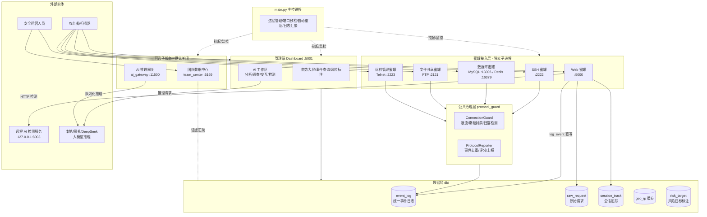
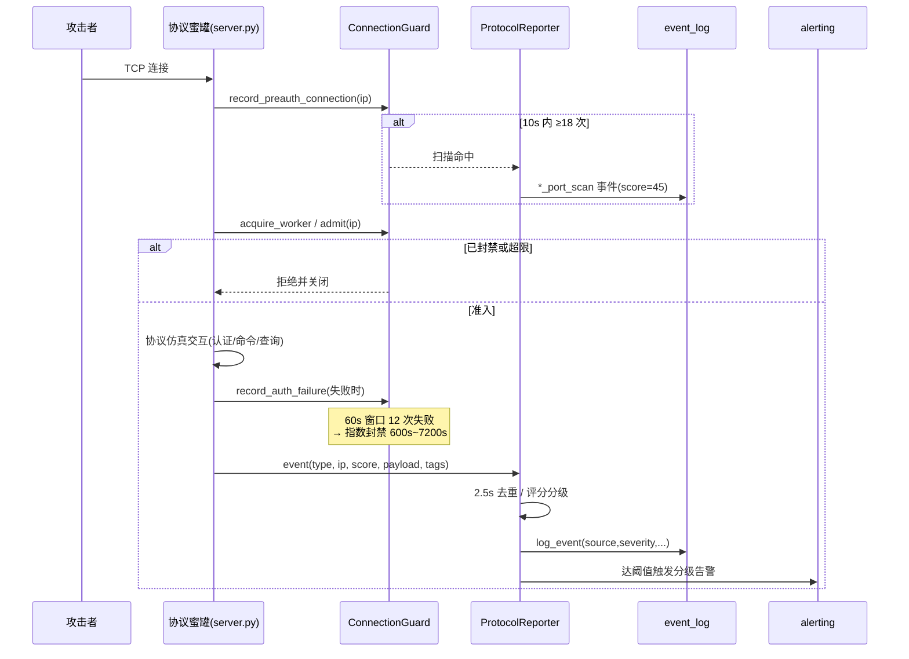
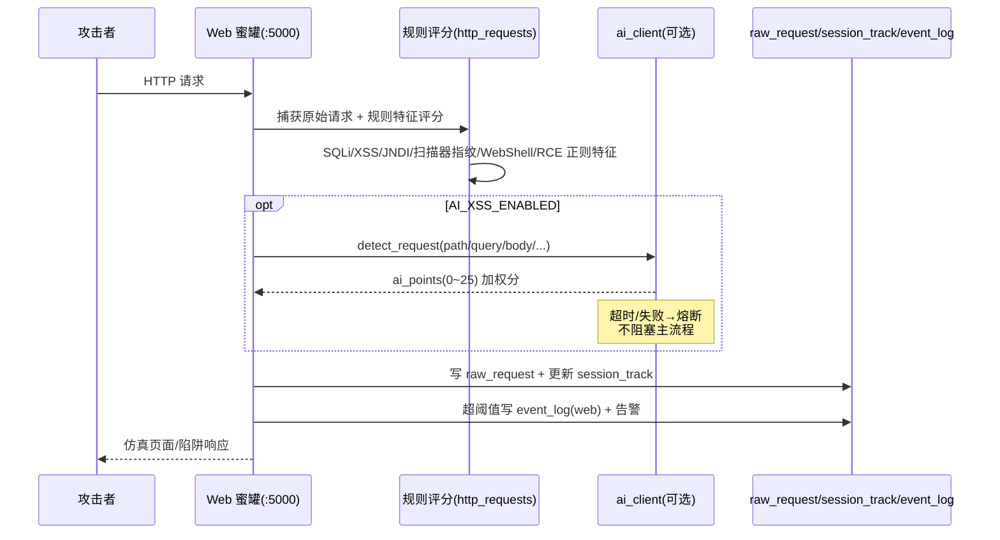

# 概要设计说明书（系统架构设计文档）

| 项目 | 说明 |
| ---- | ---- |
| 系统名称 | 基于蜜罐技术的网络威胁捕获与态势感知系统（Honeypot System） |
| 文档版本 | V1.0 |
| 编制日期 | 2026-10-22 |
| 适用范围 | 本系统整体架构、分层、模块划分、技术选型、关键数据流与接口策略 |

---

## 1. 引言

### 1.1 编写目的

本文档从总体角度确定系统的分层结构、模块划分、技术选型、关键数据流与接口策略，作为详细设计、数据库设计、接口设计以及后续开发、测试、部署的依据。

### 1.2 系统概述

本系统是一套多协议蜜罐诱捕与威胁态势感知平台。系统同时对外提供 SSH、Web、MySQL、Redis、FTP、Telnet 六类高交互/中交互蜜罐服务，诱捕攻击者并完整记录其行为；所有攻击事件经统一治理层（限流、爆破封禁、扫描检测、威胁评分）处理后，写入统一事件日志；管理端大屏（Dashboard）对事件进行可视化态势感知、风险目标标注与 AI 辅助分析。系统可选配团队数据中心与 AI 推理网关两个独立子服务，支持多节点证据汇聚与多成员共享 AI 推理。

### 1.3 设计目标

- **多协议覆盖**：一套系统同时仿真 SSH/Web/MySQL/Redis/FTP/Telnet 六类协议服务。
- **统一事件模型**：所有协议的攻击行为归一化为统一事件（来源/级别/类型/源 IP/会话/标签/载荷）。
- **治理与接入分离**：协议接入层只负责协议仿真与特征评分，限流、封禁、告警等治理由公共层复用。
- **可观测**：管理端大屏实时呈现攻击地图、事件流、会话攻击链、可疑请求与风险目标。
- **可扩展**：新增协议蜜罐仅需“配置映射 + 事件白名单 + 主程序注册”三步接入。
- **安全降级**：AI 能力默认关闭，远程 AI 服务不可达时熔断降级，不影响蜜罐主流程。

---

## 2. 总体架构

### 2.1 架构总览

系统采用“主控进程 + 多子服务进程”的多进程架构。`main.py` 作为统一启动入口与主控制器，以子进程方式拉起全部蜜罐服务与管理端，并负责端口预检、日志流式汇聚、崩溃自动重启与凭证汇总展示。

### 2.2 系统分层

系统自上而下分为五层：

| 层次 | 职责 | 主要组成 |
| ---- | ---- | ---- |
| **接入层（蜜罐仿真层）** | 协议仿真、诱饵交互、攻击行为捕获与特征评分 | `ssh_honeypot`、`web_honeypot`、`db_honeypot`、`file_honeypot`、`remote_honeypot` |
| **治理层（公共防护层）** | 连接限流、爆破检测与指数封禁、预认证扫描检测、事件去重与统一上报 | `utils/protocol_guard.py`（ConnectionGuard / ProtocolReporter） |
| **数据层** | 统一事件日志、原始请求、会话追踪、地理缓存、风险目标的存取与归档 | `db/`（connection / event_logs / http_requests / risk_targets / geo / archive / demo_data） |
| **应用层（管理与分析层）** | 态势可视化、事件查询、风险标注、登录认证、AI 辅助分析 | `dashboard/`（server / system_info / templates / static） |
| **智能层（可选）** | AI 状态监控、批量事件分析、攻击调查、交互式问答、AI 检测复核 | `utils/ai_*`、`utils/local_ai.py`、`utils/ai_client.py`、`team_center/`、`ai_gateway/` |

横切支撑：`app_config.py`（统一配置）、`utils/logger.py`（日志）、`utils/alerting.py`（分级告警）、`utils/ip_location.py`（地理定位）、`env_utils.py`（环境变量工具）。

### 2.3 进程/端口拓扑

| 服务 | 进程入口 | 默认监听 | 默认状态 |
| ---- | ---- | ---- | ---- |
| SSH 蜜罐 | `ssh_honeypot/server.py` | 0.0.0.0:2222 | 启用 |
| Web 蜜罐 | `web_honeypot/server.py` | 0.0.0.0:5000 | 启用 |
| 管理端 | `dashboard/server.py` | 127.0.0.1:5001 | 启用 |
| 数据库蜜罐 | `db_honeypot/server.py` | MySQL 0.0.0.0:13306 / Redis 0.0.0.0:16379 | 启用（`DB_HONEYPOT_ENABLED`） |
| 文件共享蜜罐 | `file_honeypot/server.py` | 0.0.0.0:2121 | 启用（`FILE_HONEYPOT_ENABLED`） |
| 远程管理蜜罐 | `remote_honeypot/server.py` | 0.0.0.0:2223 | 启用（`REMOTE_HONEYPOT_ENABLED`） |
| 团队数据中心 | `scripts/team_center.py serve` | 127.0.0.1:5169 | 关闭（`TEAM_CENTER_ENABLED` + `deployment/center/center.json`） |
| AI 推理网关 | `ai_gateway/server.py` | 127.0.0.1:11500 | 关闭（`AI_GATEWAY_ENABLED` + `deployment/gateway/gateway.json`） |

主控特性：
- 启动前逐端口预检，冲突即中止并提示；
- 子进程 stdout/stderr 流式读取（防管道阻塞），按服务着色汇聚；
- 子进程异常退出自动重启（默认最多 5 次、间隔 3 秒，可配 `MAX_RESTART_ATTEMPTS` / `RESTART_DELAY`）；
- 汇总展示各蜜罐诱饵凭证（`CRED::user::pass` 行采集）。

---

## 3. 模块划分

### 3.1 蜜罐接入层

| 模块 | 职责 | 关键文件 |
| ---- | ---- | ---- |
| SSH 蜜罐 | 高交互 SSH 终端仿真：密码认证、虚拟文件系统、命令解析与审计、会话录像 | `ssh_honeypot/server.py`、`session.py`、`commands.py`、`vfs.py`、`ssh_config.py` |
| Web 蜜罐 | 企业站仿真 + 管理后台陷阱：公开页、伪后台登录、伪 API、敏感路径陷阱、上传诱捕 | `web_honeypot/server.py`、`routes_public.py`、`routes_traps.py`、`admin_views.py`、`admin_api.py`、`errors.py` |
| 数据库蜜罐 | 单进程双监听：MySQL 协议握手/认证/查询仿真；Redis RESP 协议仿真 | `db_honeypot/server.py`、`mysql_handler.py`、`redis_handler.py` |
| 文件共享蜜罐 | FTP 协议仿真（含 PASV、伪文件系统、匿名登录诱捕） | `file_honeypot/server.py`、`ftp_handler.py` |
| 远程管理蜜罐 | Telnet(IoT) 协议仿真（协商、登录、busybox 风格 shell） | `remote_honeypot/server.py`、`telnet_handler.py` |

接入约定：每个协议蜜罐持有独立的 `ConnectionGuard` 与 `ProtocolReporter` 实例（互不影响），事件经治理层写入 `event_log`，`source` 分别为 `ssh/web/mysql/redis/ftp/telnet`。

### 3.2 治理层

`utils/protocol_guard.py` 提供：

- **ConnectionGuard**：每协议一个内存态状态机，负责全局/单 IP 并发限制、worker 信号量、认证失败窗口计数、指数退避封禁（60 秒窗口 12 次失败 → 600 秒起指数退避、上限 7200 秒）、预认证端口扫描检测（10 秒窗口 18 次连接）与扫描告警冷却。
- **ProtocolReporter**：事件 2.5 秒窗口去重、威胁分→严重度映射（<40 low / 40–59 medium / 60–79 high / ≥80 critical）、统一调用 `log_event` 并触发分级告警。
- **会话标识**：`{protocol}-{md5(ip+1小时窗)[:16]}`，同一来源一小时聚合为同一会话，供攻击链关联。

### 3.3 数据层

`db/` 包统一封装存储访问，默认 SQLite（`database/event_logs.db`），可通过配置切换 MySQL（`DB_TYPE=mysql`，初始化脚本 `database/schema.sql`）：

| 模块 | 职责 |
| ---- | ---- |
| `connection.py` | 连接管理、SQLite 忙重试、敏感文本脱敏、文本截断、配置读取 |
| `event_logs.py` | 统一事件写入（归一化/脱敏/限长）与多维查询、统计聚合（含冷归档合并） |
| `http_requests.py` | Web 原始请求捕获、规则特征评分（SQLi/XSS/JNDI/表达式注入/扫描器指纹/WebShell/命令执行）、会话行为分析 |
| `risk_targets.py` | 风险目标标注：从事件自动识别（阈值聚合）+ 人工标注，人工标注不被自动刷新覆盖 |
| `geo.py` / `utils/ip_location.py` | IP 地理定位与 geo_ip 缓存 |
| `archive.py` | 冷数据归档（raw_request/session_track/event_log → 归档库） |
| `demo_data.py` | 无真实数据时的演示数据（默认关闭，`ALLOW_DASHBOARD_MOCK_DATA`） |

### 3.4 应用层（管理端 Dashboard）

Flask 应用（`dashboard/server.py`），主要功能区：

- **认证与安全**：登录（限速 + 审计）、会话鉴权、CSRF（`X-CSRF-Token` 头 + Referer/Origin 同源校验）、安全响应头（CSP/X-Frame-Options/nosniff）、HTTP 指纹伪装。
- **态势大屏**：事件统计、攻击地图（geo）、实时事件流、可疑请求、会话攻击链、服务器信息、系统状态、登录审计。
- **风险目标标注**：列表/自动识别触发/新建/更新/删除。
- **AI 工作区**：AI 状态与探针、批量分析（scan/mode/review/retry/export）、攻击调查（investigations）、交互问答（chat）、AI 检测复核（detections）、归档查看。

### 3.5 智能层（round 9 合并，默认备用）

| 模块 | 职责 |
| ---- | ---- |
| `utils/ai_settings.py` | AI 配置加载与强校验；provider 三分支：`local`（Ollama）/ `gateway`（共享网关）/ `deepseek`（DeepSeek API，要求 https + `sk-` 前缀 key） |
| `utils/local_ai.py` | 本地/网关/DeepSeek 统一推理封装、熔断、并发与速率限制 |
| `utils/ai_analyst*.py` | 批量事件分析：游标推进、证据选择、任务队列、报告与复核 |
| `utils/investigations.py` | 攻击调查案例管理（冲突安全的修订机制） |
| `utils/ai_detection*.py` | AI 检测队列与结果存储（抽样式检测） |
| `utils/ai_interaction*.py` | Web 交互式问答会话与步骤记录 |
| `utils/ai_client.py` | 远程 HTTP 检测客户端（默认关）：请求脱敏、熔断降级、v2 契约解析、响应合法性校验、模型信息缓存 |
| `team_center/` | 团队数据中心：多设备证据汇聚、成员/传感器管理、调查作业、反馈与导出、审计 |
| `ai_gateway/` | AI 推理网关：多客户端共享的持久化优先级推理队列（SQLite WAL）、令牌认证、配额与公平调度 |

---

## 4. 技术选型

| 领域 | 选型 | 说明 |
| ---- | ---- | ---- |
| 语言 | Python 3.11+（开发环境 3.12，uv 管理 venv） | 全系统统一 |
| Web 框架 | Flask + Werkzeug | Dashboard、Web 蜜罐、team_center、ai_gateway |
| SSH 协议 | Paramiko | SSH 蜜罐服务端仿真 |
| 数据库（主） | SQLite（默认）/ MySQL（可选，`pymysql`） | 统一 `db/connection.py` 双后端 |
| 缓存/队列（AI 运行时） | SQLite WAL（`database/ai_runtime.db` 等，各 store 自建） | 不写入 MySQL `schema.sql` |
| 前端 | 原生 HTML/CSS/JS（模板渲染 + fetch 轮询） | 无构建链，CSP 严格同源 |
| AI 推理 | Ollama（本地）/ ai_gateway（共享）/ DeepSeek API | `ai.local.ini` 配置，默认关闭 |
| 远程 AI 检测 | 独立 HTTP 服务（v2 契约，`ai_points` 加权分） | `utils/ai_client.py`，默认关闭 |
| 部署 | `main.py` 多进程编排，支持 systemd 托管检测 | Windows/Linux 均可 |

选型要点：
- **SQLite 默认**：零依赖部署；`SQLITE_BUSY_RETRY` 重试与 WAL 缓解并发写；
- **MySQL 可选**：`DB_TYPE=mysql` 显式开启，`schema.sql` 仅用于主库初始化；
- **无外部中间件**：队列、熔断、缓存均为进程内/SQLite 实现，降低部署复杂度；
- **AI 默认关闭**：所有 AI 能力均须显式启用，降级路径不阻塞蜜罐主流程。

---

## 5. 关键数据流

### 5.1 TCP 蜜罐攻击捕获流（SSH/MySQL/Redis/FTP/Telnet）

### 5.2 Web 蜜罐请求捕获流

### 5.3 态势感知消费流

管理端浏览器登录后，前端按各自轮询周期调用 `/api/*`：事件统计、攻击地图、实时事件流、可疑请求、会话分析、风险目标等；后端从 `db/` 查询（含冷归档合并、统计缓存 3 秒 TTL），前端渲染大屏与列表。风险标注的写操作需 CSRF Token + 同源 Referer 校验。

### 5.4 AI 分析流（可选）

1. `ai_analyst` 后台 worker 按游标从 `raw_request`/`event_log` 取新数据 → 证据选择（`evidence_selection`）→ 组装分析任务 → 经 `local_ai`（local/gateway/deepseek 三分支）推理 → 报告落 `analyst_*` 表 → 前端展示与人工 review。
2. `ai_detection` 对抽样请求异步检测，结果落 `ai_detections`，可在检测页复核/重试。
3. provider=gateway 时，推理请求经 `ai_gateway` 持久化队列（优先级 + 每客户端配额 + 公平调度）转发至模型端点。
4. 远程 XSS 检测链路（`ai_client`）与上述独立，供 Web 蜜罐实时加权评分使用。

### 5.5 团队汇聚流（可选）

各蜜罐节点 `team_collector` 以游标方式增量抽取本地事件 → outbox 批量上报（Bearer 传感器令牌）→ `team_center` 验签、去重（批次 digest）入库 → 成员按授权传感器范围检索证据、发起调查作业、导出报告，全程审计。

---

## 6. 接口策略

### 6.1 接口分类与契约

| 接口面 | 消费者 | 契约风格 | 鉴权 |
| ---- | ---- | ---- | ---- |
| Dashboard `/api/*` | 管理端前端 | JSON，统一 `{code,message,data}`（`code=0` 成功） | Session 登录；写操作附加 `X-CSRF-Token` + 同源 Referer |
| Web 蜜罐伪接口 `/admin/api/*` | 攻击者（诱捕） | 仿真业务 API，行为全记录 | 伪认证（诱饵） |
| 远程 AI 检测 `:8003` | web_honeypot / ai_client | v2 契约：请求 path/query/body/method/ua 等；响应 attack_type/is_attack/attack_prob/ai_points(0–25)/confidence/high_risk/reasons/signals/model_label | 内网回环地址部署 |
| AI 网关 `:11500 /v1/*` | local_ai(gateway 分支) | `/v1/jobs` 提交/查询/取消、`/v1/status`；幂等 `request_id` | 每客户端 Bearer Token（SHA-256 散列比对） |
| 团队中心 `:5169 /api/*` | 成员浏览器 / 传感器节点 | JSON；浏览器走 Session+CSRF；传感器走 Bearer | 登录限速、角色（admin/analyst/viewer）、传感器令牌 |

### 6.2 通用设计原则

- **幂等**：AI 网关与团队中心作业均以 `request_id`（24 位十六进制）去重，重复提交返回原任务。
- **限界**：所有入参做长度/数量上限校验（如网关 messages ≤12、payload ≤24KB、team_center body ≤256KB）。
- **降级**：AI 相关接口在 AI 不可用时返回明确状态（`fallback`/错误码），绝不阻塞蜜罐捕获主链路。
- **脱敏**：所有出站至 AI 的文本先经敏感字段（password/token/secret/api_key/authorization 等）正则脱敏。
- **审计**：登录、导出、标注、传感器管理等敏感操作写审计记录。

### 6.3 配置与注册策略

- 统一配置优先级：环境变量 > `honeypot.ini` > 代码默认值（`app_config.py` 的 `_ENV_CONFIG_MAP` 统一映射）。
- AI 独立配置：`ai.local.ini`（`HONEYPOT_AI_CONFIG` 可覆盖路径），与主配置隔离。
- team_center / ai_gateway 使用独立 JSON（`deployment/center|gateway/*.json`），main.py 仅在 `enabled` 且文件存在时注册子进程，缺失打印提示跳过。
- 新增协议蜜罐接入三步：`app_config.py` 增加配置映射 → `event_logs.py` source 白名单加入标识 → `main.py` 注册服务。

---

## 7. 部署与运行

- 一键启动：`python main.py`（需先建 `ssh_honeypot/state/` 目录，密钥生成逻辑已含自动创建补丁）。
- 配置文件：`honeypot.ini`（主）、`ai.local.ini`（AI，可选）、`deployment/center/center.json` 与 `deployment/gateway/gateway.json`（可选子服务）。
- 运行产物：`logs/`（日志）、`database/*.db`（SQLite 运行库），均不纳入版本库与打包。
- 生产建议：`PRODUCTION_MODE=1`、Dashboard 仅绑回环 + 反向代理、`DASHBOARD_SESSION_COOKIE_SECURE=1`（HTTPS 下）。

## 8. 非功能设计要点

- **性能**：事件统计 3 秒缓存、聚合查询分批（1000/批）、SQLite WAL、大屏分窗限量（24h/7d/30d 三档限额）。
- **可靠性**：子进程崩溃自动重启、数据库写重试、AI 熔断（连续 3 次失败退避 30 秒）。
- **安全**：管理端全链路 CSRF/同源校验、登录限速与审计、敏感文本入库前脱敏、HTTP 指纹伪装、严格 CSP。
- **可维护性**：分层清晰、治理复用、配置集中、协议接入约定统一。
