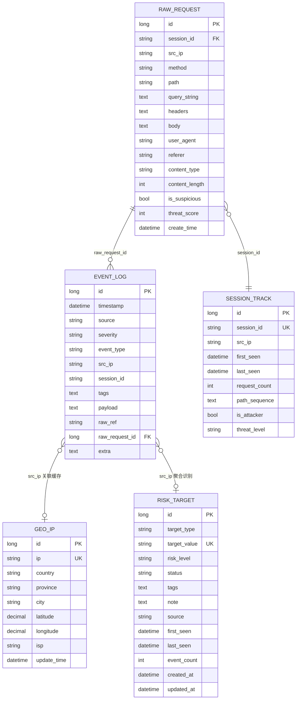

# 数据库设计说明书

| 项目 | 说明 |
| ---- | ---- |
| 系统名称 | 基于蜜罐技术的网络威胁捕获与态势感知系统 |
| 文档版本 | V1.0 |
| 编制日期 | 2026-10-22 |
| 关联文档 | 《概要设计说明书》《详细设计说明书》《接口（API）设计文档》 |

---

## 1. 数据库总体设计

### 1.1 存储布局

系统采用“一主多辅”的多库存储布局，按数据生命周期与访问域隔离：

| 库 | 引擎 | 文件/位置 | 内容 | 初始化方式 |
| ---- | ---- | ---- | ---- | ---- |
| 主库（默认） | SQLite | `database/event_logs.db` | geo_ip、raw_request、session_track、event_log、risk_target | `db/` 各模块 CREATE IF NOT EXISTS 自初始化 |
| 主库（可选） | MySQL 8（utf8mb4） | `honeypot_db` | 同上 5 表 | `database/schema.sql` 手动初始化（仅切换 MySQL 时使用） |
| 归档库 | MySQL | `honeypot_archive` | raw_request/session_track/event_log 冷数据 | schema.sql 末尾 `CREATE TABLE ... LIKE` |
| AI 运行时库 | SQLite(WAL) | `database/ai_runtime.db` 等 | ai_calls/ai_detections/analyst_*/investigations/interaction_* 等 | 各 store 模块自初始化，**不写入 schema.sql** |
| 团队中心库 | SQLite | `deployment/center/center.sqlite` | users/sensors/evidence/center_jobs 等 | `scripts/team_center.py init` |
| 网关队列库 | SQLite(WAL) | gateway.json 指定路径 | jobs/gateway_state | ai_gateway 启动自建 |
| 采集器库 | SQLite | team_collector 运行目录 | sources/outbox/generations/state | team_collector 自建 |

> 设计要点：`database/schema.sql` **仅用于 MySQL 主库初始化**；AI 运行时各表由各 store 在独立 SQLite 中自初始化，避免污染 MySQL 初始化脚本。SQLite 与 MySQL 两套 DDL 口径一致（字段名/索引对齐），由 `db/connection.py` 的 `USE_MYSQL` 开关统一切换。

### 1.2 命名与通用约定

- 时间字段：SQLite 侧为 `DATETIME` 文本（`YYYY-MM-DD HH:MM:SS`，北京时间）；MySQL 侧为 `DATETIME` 类型；AI/中心库使用 Unix 时间戳 `REAL`。
- 文本字段统一 UTF-8（MySQL `utf8mb4_unicode_ci`）。
- 所有写入前经 `_truncate_text` 限长与 `_redact_sensitive_text` 脱敏（详见详细设计 4.1）。
- 表自初始化采用“双检锁 + CREATE IF NOT EXISTS”，MySQL 侧附带幂等列/索引迁移。

---

## 2. ER 图

关系说明：
- `event_log.raw_request_id → raw_request.id`：Web 事件回溯原始请求（逻辑外键，应用层维护，不做物理外键以兼顾归档搬迁）。
- `raw_request.session_id ↔ session_track.session_id`：同会话聚合（逻辑关联）。
- `geo_ip.ip` 为 `event_log.src_ip` / `raw_request.src_ip` 的地理缓存（弱关联，容忍缺失）。
- `risk_target.target_value` 由 `event_log.src_ip` 聚合自动识别产生（单向派生，无物理外键）。

---

## 3. 主库表结构详述

### 3.1 geo_ip — IP 地理位置缓存表

| 字段 | 类型(MySQL) | 约束 | 说明 |
| ---- | ---- | ---- | ---- |
| id | BIGINT UNSIGNED AUTO_INCREMENT | PK | 主键 |
| ip | VARCHAR(45) | NOT NULL, UK(uk_geo_ip_ip) | IP 地址（兼容 IPv6） |
| country | VARCHAR(64) | | 国家 |
| province | VARCHAR(64) | | 省/州 |
| city | VARCHAR(64) | | 城市 |
| latitude | DECIMAL(10,7) | | 纬度 |
| longitude | DECIMAL(10,7) | | 经度 |
| isp | VARCHAR(128) | | 运营商 |
| update_time | DATETIME | DEFAULT CURRENT_TIMESTAMP ON UPDATE | 缓存刷新时间 |

用途：GeoLite2 查询结果的持久缓存，作为缓存表不参与冷归档。

### 3.2 raw_request — 原始请求捕获表

| 字段 | 类型 | 约束 | 说明 |
| ---- | ---- | ---- | ---- |
| id | BIGINT UNSIGNED AUTO_INCREMENT | PK | 主键 |
| session_id | VARCHAR(64) | KEY idx_raw_session | 会话 ID（1 小时滑窗 md5） |
| src_ip | VARCHAR(45) | NOT NULL, KEY idx_raw_ip | 源 IP |
| method | VARCHAR(16) | | 请求方法 |
| path | VARCHAR(1024) | | 请求路径 |
| query_string | TEXT | | URL 参数 |
| headers | MEDIUMTEXT | | 请求头（JSON 串） |
| body | MEDIUMTEXT | | 请求体（截断存储） |
| user_agent | VARCHAR(500) | | UA |
| referer | VARCHAR(500) | | Referer |
| content_type | VARCHAR(100) | | Content-Type |
| content_length | INT | DEFAULT 0 | 内容长度 |
| is_suspicious | TINYINT(1) | DEFAULT 0 | 是否可疑 |
| threat_score | INT | DEFAULT 0 | 威胁评分 0–100 |
| create_time | DATETIME | DEFAULT CURRENT_TIMESTAMP | 捕获时间 |

联合索引：`idx_raw_suspicious_score_time (is_suspicious, threat_score, create_time)`——支撑“可疑请求列表”按分+时间扫描。

### 3.3 session_track — 会话追踪表

| 字段 | 类型 | 约束 | 说明 |
| ---- | ---- | ---- | ---- |
| id | BIGINT UNSIGNED AUTO_INCREMENT | PK | 主键 |
| session_id | VARCHAR(64) | NOT NULL, UK | 会话 ID |
| src_ip | VARCHAR(45) | NOT NULL, KEY idx_session_ip | 源 IP |
| first_seen / last_seen | DATETIME | | 首次/最后出现 |
| request_count | INT | DEFAULT 1, KEY | 请求次数 |
| path_sequence | TEXT | | 路径序列（攻击链还原） |
| is_attacker | TINYINT(1) | DEFAULT 0 | 是否判定攻击者 |
| threat_level | VARCHAR(16) | DEFAULT 'unknown' | unknown/low/medium/high/critical |

索引：`idx_session_last_seen` 支撑活跃会话排序。

### 3.4 event_log — 统一事件日志表（核心）

| 字段 | 类型 | 约束 | 说明 |
| ---- | ---- | ---- | ---- |
| id | BIGINT UNSIGNED AUTO_INCREMENT | PK | 主键 |
| timestamp | DATETIME | NOT NULL DEFAULT CURRENT_TIMESTAMP, KEY idx_event_time | 事件时间（北京时间） |
| source | VARCHAR(16) | NOT NULL, KEY idx_event_source | 来源白名单：web/ssh/dashboard/system/mysql/redis/ftp/smb/rdp/telnet（白名单外归一化为 system） |
| severity | VARCHAR(16) | NOT NULL, KEY idx_event_severity | low/medium/high/critical |
| event_type | VARCHAR(64) | NOT NULL, KEY idx_event_type | 事件类型（写入前 lower + 限长 64） |
| src_ip | VARCHAR(64) | DEFAULT '', KEY idx_event_ip | 来源 IP |
| session_id | VARCHAR(64) | DEFAULT '' | 会话 ID |
| tags | TEXT | | 标签 JSON 数组（≤20 项，单项 ≤24 字符） |
| payload | TEXT | | 事件摘要（脱敏，默认 ≤2048 字符，`EVENT_PAYLOAD_MAX` 可配） |
| raw_ref | VARCHAR(128) | DEFAULT '' | 原始数据引用，如 `raw_request:123` |
| raw_request_id | BIGINT | NULL, KEY idx_event_raw_request | 关联 raw_request.id |
| extra | TEXT | | 扩展 JSON（脱敏，默认 ≤4096，`EVENT_EXTRA_MAX` 可配） |

写入链路唯一入口 `log_event()`；查询侧对超窗数据透明合并 `honeypot_archive`（MySQL）或归档表。

### 3.5 risk_target — 风险目标标注表

| 字段 | 类型 | 约束 | 说明 |
| ---- | ---- | ---- | ---- |
| id | BIGINT UNSIGNED AUTO_INCREMENT | PK | 主键 |
| target_type | VARCHAR(16) | DEFAULT 'ip' | 目标类型（当前仅 ip） |
| target_value | VARCHAR(64) | NOT NULL, UK uk_risk_target_value | 目标值（攻击源 IP） |
| risk_level | VARCHAR(16) | DEFAULT 'medium', KEY idx_rt_risk_level | low/medium/high/critical |
| status | VARCHAR(16) | DEFAULT 'watching', KEY idx_rt_status | watching/banned/handled |
| tags | TEXT | | 标签 JSON（≤400 字符） |
| note | TEXT | | 人工备注（≤2000 字符） |
| source | VARCHAR(16) | DEFAULT 'auto' | auto 自动识别 / manual 人工标注 |
| first_seen / last_seen | DATETIME | | 首次/最近出现 |
| event_count | INT | DEFAULT 0 | 关联事件数 |
| created_at / updated_at | DATETIME | | 创建/更新时间 |

业务规则：**source=manual 的记录在自动识别刷新时仅更新统计字段（first_seen/last_seen/event_count/updated_at），标注字段（risk_level/status/tags/note）不被覆盖**。该表为运营态数据，不纳入冷归档。

---

## 4. AI 运行时库表（SQLite 自初始化）

### 4.1 ai_store（database/ai_runtime.db）

| 表 | 关键列 | 用途 |
| ---- | ---- | ---- |
| ai_calls | call_id、状态、提示与响应摘要、耗时、时间戳 | 推理调用台账 |
| ai_leases | id PK, expires_at | 推理租约（并发互斥） |
| ai_state | id PK, failures, open_until | 熔断状态 |
| ai_waiters | id PK, expires_at | 排队等待者 |
| ai_diagnostics | call_id PK, detail | 失败诊断详情 |
| ai_scheduler | id PK, pause_until | 调度暂停 |
| ai_migrations | name PK, applied_at | 库内版本迁移 |

### 4.2 ai_analyst_store

| 表 | 关键列 | 用途 |
| ---- | ---- | ---- |
| analyst_cursors | source PK, raw_id, event_id | 各数据源消费游标 |
| analyst_evidence | id PK, source, locator, 摘要列 | 证据条目 |
| analyst_tasks | id PK, fingerprint UK, 状态列 | 分析任务（指纹去重） |
| analyst_report_items | evidence_id PK, task_id | 报告-证据关联 |
| analyst_reviews | id PK, task_id, owner, 结论列 | 人工复核 |
| analyst_attempts | id PK, task_id, attempt, 结果列 | 推理尝试记录 |
| archived_tasks（归档库） | id PK, payload, archived_at | 到期任务归档（默认保留 30 天） |

### 4.3 ai_detection_store / ai_interaction_store / investigations

| 表 | 用途 |
| ---- | ---- |
| ai_detections | 抽样检测队列与结果（状态、样本、结论、评分） |
| interaction_sessions | 交互问答会话（TTL、步数、来源 IP） |
| ai_interactions | 问答步骤明细 |
| investigations | 攻击调查案例（标题、src_ip、状态、revision） |
| investigation_reports | 案例报告快照（case_id+report_id） |
| investigation_audit | 案例操作审计 |
| alert_noise | 告警降噪状态（key PK, first/last/count） |
| detection_reviews / review_audit（team_store） | 检测结果复核与审计 |
| period_reports / period_settings（team_store） | 周期报告与开关 |
| evaluation_runs（team_store） | 评估运行记录 |
| sources / outbox / generations / state（team_collector） | 采集游标、待发箱、代际锚点、运行态 |

---

## 5. 团队中心库（center.sqlite）

| 表 | 关键列与约束 | 用途 |
| ---- | ---- | ---- |
| users | id PK, name UK, password(散列), role, active | 成员账号（admin/analyst/viewer） |
| sensors | id PK, name, token_hash UK, active, last_seen, health | 传感器节点（Bearer 令牌散列） |
| grants | (user_id, sensor_id) PK | 成员-传感器授权范围 |
| evidence | id PK, sensor_id, source_id, table_name, record_id, timestamp, src_ip, session_id, kind, origin, document | 汇聚证据（JSON 文档） |
| batches | (sensor_id, id) PK, digest, created | 上报批次去重（digest） |
| audit | id PK, created, actor, action, target | 操作审计 |
| member_metrics | id PK, sensor_id, document, created | 节点指标 |
| center_evaluations / center_replays | id PK, document, created | 评估与回放文档 |
| center_jobs | id PK, owner, request_id, UNIQUE(owner,request_id), status, deadline, lease, result_json | 调查作业（幂等） |
| center_steps / center_calls | job_id 关联 | 作业步骤与推理调用 |
| center_feedback | job_id PK, revision, verdict, note, actor | 作业反馈（revision 冲突控制） |
| center_feedback_audit | job_id, document, created | 反馈审计 |

## 6. AI 网关队列库

| 表 | 关键列与约束 | 用途 |
| ---- | ---- | ---- |
| jobs | id PK, client, request_id, task, priority, status, created/started/finished/deadline, lease, cancel_requested, input_json, result_json, reason, UNIQUE(client,request_id) | 持久化推理队列；索引 jobs_queue(status,priority,created)、jobs_client(client,created) |
| gateway_state | id PK, failures, blocked_until, last_success | 全局熔断状态 |

清理策略：queued 超 120s、running 超 75s 置 fallback；完成态保留 1 小时删除。

---

## 7. 数据字典（核心枚举值）

| 枚举 | 取值 | 含义 |
| ---- | ---- | ---- |
| event_log.source | web / ssh / dashboard / system / mysql / redis / ftp / smb / rdp / telnet | 事件来源（白名单外归一化 system；smb/rdp 为预留） |
| event_log.severity | low / medium / high / critical | <40 / 40–59 / 60–79 / ≥80 威胁分映射 |
| event_log.event_type（示例） | login_failed、login_success、path_probe、sql_injection、xss_attempt、webshell_probe、cmd_exec、*_port_scan、ssh_cmd_audit、redis_command、ftp_login、telnet_command | 小写限长 64；`ssh_cmd_audit/ssh_cmd_suspicious/web/web_activity_note` 为隐藏类型，不参与风险聚合 |
| risk_target.risk_level | low / medium / high / critical | 非法值归一化 medium |
| risk_target.status | watching / banned / handled | 观察 / 已封禁 / 已处置 |
| risk_target.source | auto / manual | 自动识别 / 人工标注 |
| session_track.threat_level | unknown / low / medium / high / critical | 会话威胁等级 |
| ai 任务状态 | queued / running / completed / fallback / cancelled | 网关与分析任务状态机 |
| team_center role | admin / analyst / viewer | 成员角色 |

## 8. 索引与性能设计

- 高频过滤列均建索引：event_log 的 time/source/severity/type/ip/raw_request_id 六索引；raw_request 的 ip/session + (is_suspicious,score,time) 复合索引。
- 查询统一 limit ≤500 / offset ≤50000 钳制；统计接口 3s 进程内缓存。
- SQLite 开启 WAL + busy_timeout 重试；MySQL 使用 InnoDB + utf8mb4。
- 冷数据经 `db/archive.py` 定期搬迁至归档库，主表保持轻量；查询侧按时间窗自动合并主库+归档库结果。

## 9. 数据安全与合规

- 入库前统一脱敏（password/token/secret/api_key/authorization/令牌/密钥 → `<redacted:hash>`）。
- 事件载荷/扩展字段强制限长，防存储放大。
- risk_target 等运营数据不归档、不随冷数据迁移；审计类表（audit/review_audit/investigation_audit）只增不改。
- 运行库文件（`database/*.db`、`*.sqlite`）不纳入版本库与分发包。
