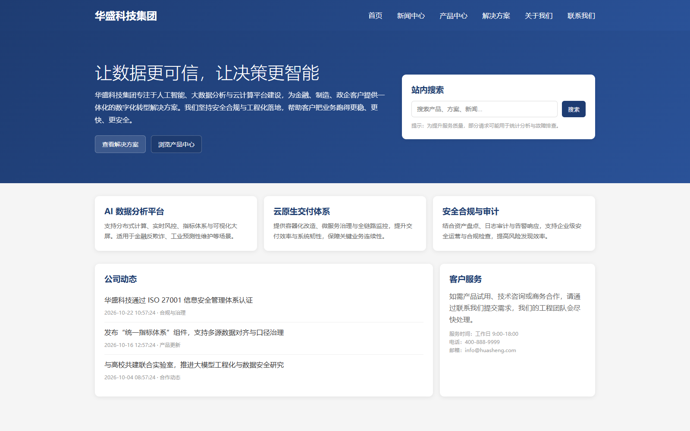
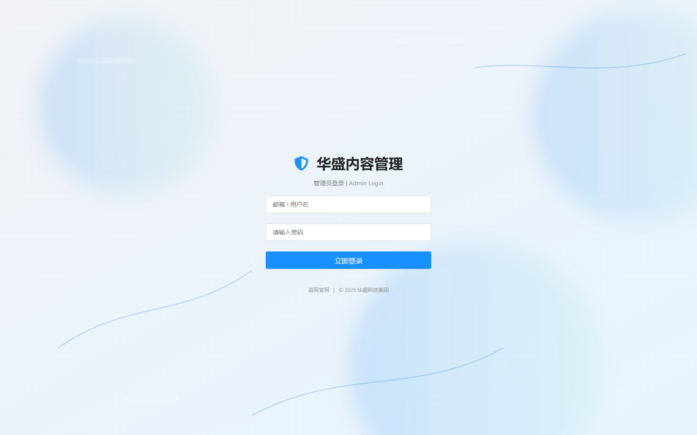
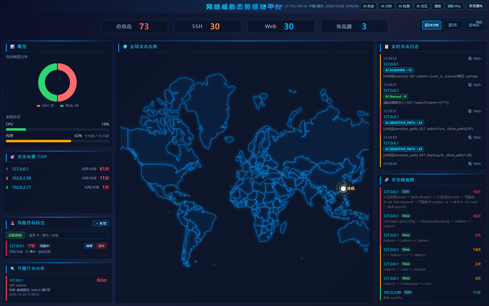
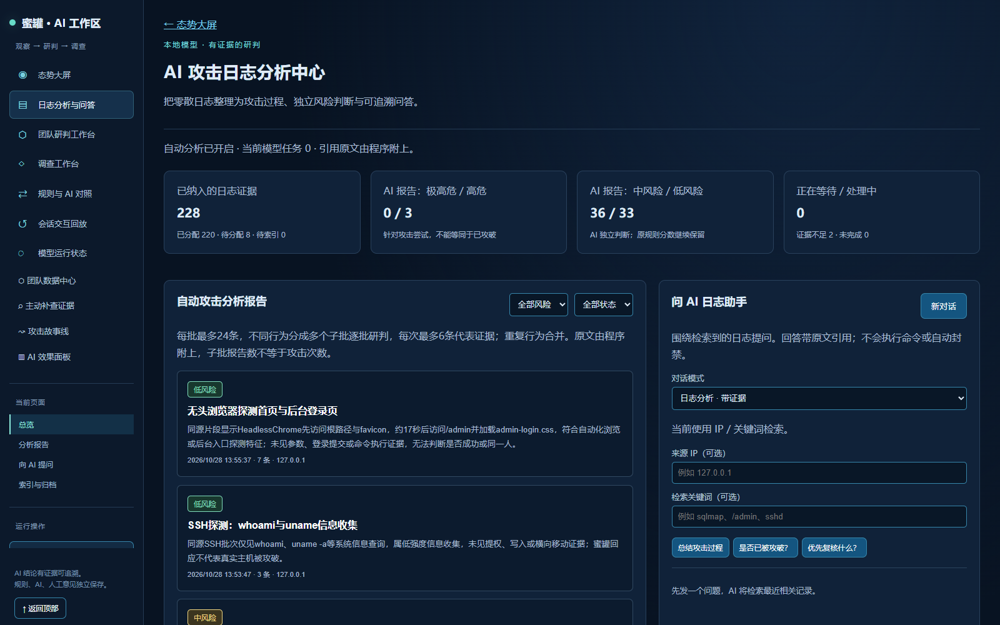
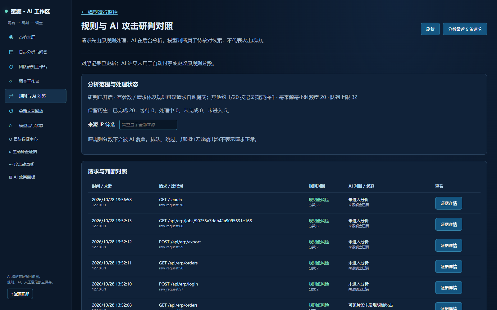
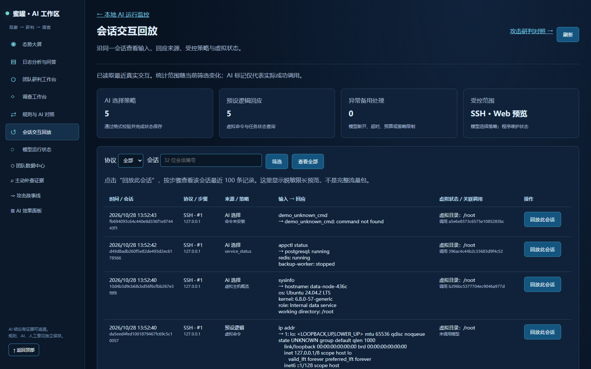
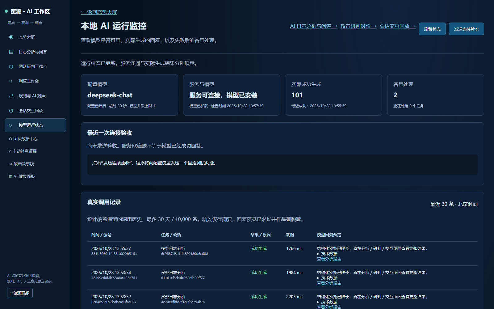
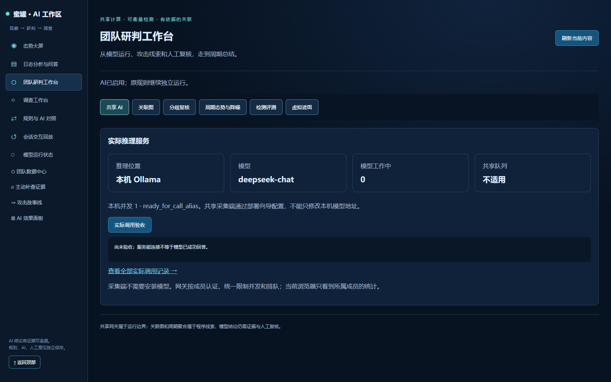

# 蜜罐系统测试执行报告（六协议 + AI 双链路）

> 执行时间：2026-10-28 13:51 — 14:00（Asia/Shanghai）
> 被测系统：`C:\Users\ADMIN\Desktop\honeypot-system-main`（本机回环，真实运行 `main.py`）
> 测试脚本：`scripts/mixed_attack_demo.py`、`scripts/demo/protocol_traffic.py`
> 原始数据：见 `docs/test-run/`（demo JSON/MD、protocol.json、telnet.json、summary.json）

---

## 1. 测试环境

| 项 | 值 |
| --- | --- |
| 操作系统 | Windows（本机） |
| Python | 3.12（项目 `.venv`） |
| 主控 | `main.py` 拉起 7 个子服务，端口全部监听成功 |
| SSH 蜜罐 | `0.0.0.0:2222`（诱饵账号 root / ubuntu / backup） |
| Web 蜜罐 | `0.0.0.0:5000`（含 `/admin` 诱饵后台、`/api/preview`、`/api/erp/*`） |
| 管理端 | `127.0.0.1:5001`（登录 admin，配置文件内密码） |
| 数据库蜜罐 | MySQL `13306` + Redis `16379` |
| 文件共享蜜罐 | FTP `2121` |
| 远程管理蜜罐 | Telnet `2223` |
| 请求级 AI 检测 | 模型服务 v2 由主控拉起：`127.0.0.1:8003`（`/health`、`/model/info` 正常） |
| 通用大模型 | DeepSeek（`ai.local.ini`，报告/问答/受控交互实际调用成功） |

浏览器截图使用 Edge Headless（Playwright 驱动，1600×1000）。

---

## 2. 测试数据生成

### 2.1 Web / 受控交互 / 虚拟业务（22 步）

```powershell
uv run python scripts/mixed_attack_demo.py --business --gap 1 --timeout 15 --output docs/test-run
```

运行标记：`hp_demo_20261028_135144_4da7`

| 分组 | 内容 | HTTP 结果 |
| --- | --- | --- |
| 正常访问 | `/` 连通性、正常搜索、安全讨论关键词 | 200 ×3 |
| 入口探测 | `/admin` 管理入口、`sqlmap/1.8` 扫描器 UA | 200 ×2 |
| 输入探测 | XSS、SQL 联合查询、路径遍历、命令拼接、SSTI、XXE、SSRF 预览 | 200 ×4、404 ×2、400 ×1 |
| 受控交互 | `/api/preview`（SSRF 内网目标、外部示例）与任务轮询 | **202 ×2 → 轮询 200 ×2** |
| 业务交互 | `/api/erp/status|catalog|orders|login|export` 与导出任务 | 200 ×4、401 ×1、202 ×1、200 ×1 |

### 2.2 多协议流量（MySQL / Redis / FTP / Telnet / SSH）

```powershell
uv run python scripts/demo/protocol_traffic.py --ssh-password 123456 --json docs/test-run/protocol.json
uv run python scripts/demo/protocol_traffic.py --only telnet --telnet-user root --telnet-password 123456 --json docs/test-run/telnet.json
```

| 协议 | 动作 | 结果 |
| --- | --- | --- |
| MySQL | 2 次认证尝试、1 次成功连接 + UNION 查询 | connected ×1、query_sent ×1、auth_rejected ×1 |
| Redis | `AUTH`/`INFO`/`KEYS *`/`CONFIG GET`/`GET flag` | 5 条命令均有响应 |
| FTP | 匿名与 `admin/admin` 登录、`LIST`、`RETR /etc/passwd` | 虚拟登录成功 ×2、目录列表 ×2、文件拒绝 ×2、触发 1 次爆破封禁 |
| Telnet | 首轮错误密码触发防护；第二轮正确密码进入 IoT 虚拟 shell | `D-Link DI-8003` 横幅、`uname -a`、`cat /etc/passwd`、`ls -la` 均有仿真输出 |
| SSH | 2 次错误密码 + 1 次正确登录；执行 8 条命令 | 登录成功、`whoami`/`uname -a`/`cat /etc/passwd`/`ls`/`ip addr`/`sysinfo`/`appctl status`/未知命令 |

### 2.3 追加 AI 融合验证请求（7 条）

依次发送 SQLi、路径遍历、`/.git/config`、`/backup/dump.sql`、命令拼接、`{{7*7}}` SSTI、`sqlmap` 扫描器 UA，用于覆盖 AI 各分类与融合评分。

---

## 3. 数据结果汇总（`docs/test-run/summary.json`）

| 指标 | 数值 |
| --- | --- |
| 统一事件总数 | **135** |
| 事件来源 | SSH 74 / Web 39 / Telnet 7 / FTP 6 / MySQL 5 / Redis 4 |
| `raw_request` | 78 条，其中可疑 **39** 条，最高分 **67** |
| 会话追踪 | 9 个会话，识别攻击源 **7** 个 |
| AI 参与事件 | **39** 条（`rule+ai` 28 / `rule` 11） |
| AI 判定类型分布 | sensitive_path 9、normal 6、path_traversal 4、sqli 3、xss 3、scanner 3 |
| AI 日志报告 | **81 / 81 完成**（DeepSeek 真实调用） |
| 规则-AI 对照 | 37 条，完成 20，来源额度跳过 17 |
| 受控交互 | 10 条，AI 选择策略 5，程序回应 5，备用处理 0 |
| LLM 调用审计 | **110 次，成功 108**（`log_report` 81、`web_detect` 20、`ssh_reply` 3、`web_reply` 2、`probe` 4） |

典型 AI 融合事件：

```text
xss            rule 22 + AI 25 = 47   → xss_ai_detected            final_source=rule+ai
sqli           rule 25 + AI 25 = 50   → sqli_ai_detected
path_traversal rule 22 + AI 25 = 47   → path_traversal_ai_detected
sensitive_path rule 15 + AI 25 = 40   → sensitive_path_ai_detected
scanner        rule 37 + AI 13 = 50   → scanner_ai_detected
ssti           rule 20 + AI  0 = 20   → ssti_probe（AI 判 normal，不计分）
```

---

## 4. 界面截图

### 4.1 Web 蜜罐与诱饵后台





### 4.2 态势大屏（统计 / 地图 / 实时攻击日志 / 攻击链）



实时日志中可见两类标签并存：

- `AI XSS +25`、`AI SENSITIVE PATH +25`、`AI SCANNER +13`：AI 判攻击并加分；
- `AI Normal +0`：AI 判正常，参与判定但**不加分**（见第 5 节修复 2）。

### 4.3 AI 工作区











---

## 5. 测试中发现的问题与修复

### 5.1 `/api/preview` 轮询地址与项目演示脚本不一致（已修复）

- 现象：`scripts/mixed_attack_demo.py` 只接受 `poll` 为 `/api/preview/jobs/<24位>`，而实现返回 `/api/jobs/<id>`，受控预览的「任务轮询」步骤会被判为非法地址。
- 修复：`web_honeypot/decoy_api.py` 统一返回 `/api/preview/jobs/<id>`，保留 `/api/jobs/<id>` 作为别名。
- 验证：本次 2 次预览提交均返回 202，轮询 200，见 2.1 表。

### 5.2 模型判 `normal` 时仍累加 `ai_points`，造成正常流量误报（已修复）

- 现象：截图首次采集时出现 `AI Normal +9`，把 `/static/css/admin-login.css`、`/admin`
  这类规则分 15 的请求抬到 24 → 进入可疑事件。原因是模型对 normal 也给概率映射分（实测 7~13）。
- 修复：`db/http_requests.py::_resolve_web_final_decision` 中，`attack_type=normal` 且 `is_attack=false`
  时**生效加分为 0**，AI 仍标记参与（`final_source=rule+ai`）；原始服务分保留在 `extra.ai_service_points`
  便于追溯。
- 验证（修复后）：

```text
raw_request 68  /static/css/admin-login.css  score 15  suspicious=0
raw_request 69  /admin                       score 15  suspicious=0
event 156       ssti_probe  rule 20  ai_points 0  ai_service_points 8  final_source=rule+ai
event 157       scanner_ai_detected  rule 37  ai_points 13  final_source=rule+ai
```

### 5.3 前端 AI 徽标读取原始分而非生效分（已修复）

- 现象：大屏「AI Normal +8」与后端实际计分（0）不一致。
- 修复：`dashboard/static/js/dashboard.js` 优先读取 `extra.ai_points`（生效分），缺失才回退
  `extra.ai.ai_points`（模型原始分）。当前截图中显示为 `AI Normal +0`。

> 历史事件（修复前写入）仍保留旧的 `AI Normal +9` 展示，属于数据快照差异，不做回溯改写。

---

## 6. 已知限制与观察

1. **AI 复核按来源限流**：`detection_per_ip_hour = 20`，本次全部流量来自 `127.0.0.1`，
   因此 37 条对照记录中 17 条标记「来源额度已满 / 未进入分析」。这是设计内的保护，不是故障；
   需要演示更多条目时，调大 `ai.local.ini` 的 `detection_per_ip_hour` 后重启。
2. **Telnet 防护**：同一连接连续 3 次错误密码后返回 `Too many login attempts. Connection closed.`，
   第二轮用正确诱饵密码才得到 shell，属预期行为。
3. **规则对 `/admin` 子串敏感**：`admin-login.css` 会命中「敏感路径 +15」。修复 5.2 后它不再单独成事件，
   但规则本身仍建议改成按路径段匹配（未在本次改动，避免影响既有评分口径）。
4. **AI 检测服务与通用大模型是两条独立链路**：前者只做分类/加分（8003），后者做报告、问答与受控交互
   （DeepSeek）。截图中 `规则与 AI 对照` 页的「来源额度已满」属于后者，不影响前者的 `ai_points` 融合。

---

## 7. 回归与结论

| 检查 | 结果 |
| --- | --- |
| 全量回归 `scripts/verify_project.py` | **171 tests OK**（修复后复跑） |
| 六类蜜罐事件落库 | MySQL / Redis / FTP / Telnet / SSH / Web 全部有事件 |
| 统一事件模型 | 135 条，来源、严重度、标签、载荷字段完整 |
| 大屏 | 统计、地图、实时日志、攻击链、风险目标、可疑行为均正常渲染 |
| 请求级 AI（8003） | 39 条融合事件，分数与类型正确，normal 不计分 |
| 通用大模型 | 81 份报告完成、20 条对照、10 条交互、110 次调用 108 成功 |

结论：系统在本机真实运行条件下，六类诱捕入口、统一事件模型、态势大屏、请求级 AI 融合与
通用大模型分析工作区均通过本次数据验证。

---

## 8. 复现命令

```powershell
# 1) 启动（会同时拉起 AI 检测服务 8003）
uv run python main.py

# 2) 生成 Web / ERP / 受控交互流量（22 步）
uv run python scripts/mixed_attack_demo.py --business --gap 1 --timeout 15 --output docs/test-run

# 3) 生成多协议流量（密码取自启动摘要的 SSH 诱饵密码）
uv run python scripts/demo/protocol_traffic.py --ssh-password 123456 --json docs/test-run/protocol.json
uv run python scripts/demo/protocol_traffic.py --only telnet --telnet-user root --telnet-password 123456 --json docs/test-run/telnet.json

# 4) 汇总指标
uv run python scripts/verify_project.py
```

截图目录：`docs/screenshots/`（01–11，共 11 张）。
